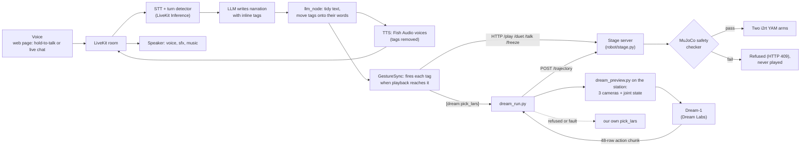

# Stage Hands

An AI voice improvises a story out loud, live, and two robot arms act it out as puppets: each gripper is a mouth,
every beat is a gesture. Anyone can cut in mid-story ("make the dragon vegan!"): the arms freeze and the story bends.

Built at MakerMods Physical AI Hacks (Founders Inc SF, Nov 7–8 2026), Creative track, by Alex, Michael and Darius,
with LiveKit, two i2rt YAM arms on the MakerMods station, and Dream Labs' Dream-1.

## The demo
Lars, a green plush frog on the table, hosts a short scripted show. A founder starts a nervous pitch; the stage
hands (the two arms) cut in, Lars takes over, introduces Alex, Michael and Darius, and pitches the project with a
dragon, a knight and a space war acted out on cue. Then a volunteer holds the big button and asks for any story:
Lars improvises about two minutes of it while the arms play the characters, duets and sound effects land on their
words, and the volunteer can interrupt at any point. The finale ends with the two arms tipping their hats.

Script: [agent/show.md](agent/show.md). Rehearsal how-to: [kb/show.md](kb/show.md).

## How it works



1. The volunteer talks into the web page (hold-to-talk for loud rooms, or open-mic live chat with LiveKit's turn
   detector and interruptions). The audio goes to a LiveKit room.
2. The storyteller agent ([agent/storyteller.py](agent/storyteller.py)) runs STT and the LLM. The LLM writes
   narration with inline tags: `[left:roar]`, `[duet:hug]`, `[ensemble:clap]`, `[talk:left] "…"`, `[sfx:laser]`,
   `[music:funny]`, `[dream:pick_lars]`.
3. Each gesture tag is moved early by the gesture's lead time (the stage's blend, the gesture's first visible hit,
   the arm's lag, minus the listener's measured playout delay) so the hit lands on its word. Tags are stripped
   before speech; each character's quoted lines get their own voice, and that arm's gripper flaps as its mouth.
4. When playback reaches a tag, it becomes an HTTP call to the stage server. The stage server plays a pre-built,
   pre-checked trajectory from the gesture library, re-checks the blend from wherever the arm is, and refuses
   anything that fails.
5. Voice, sound effects and music come back through the same room to the page's speaker.

More: [kb/system.md](kb/system.md) (how the pieces connect), [kb/storyteller.md](kb/storyteller.md),
[kb/gestures.md](kb/gestures.md).

### The gesture library
- 75 solo gestures ([robot/gestures/](robot/gestures/)): roar, slash, shoot, facepalm, double take, eye roll,
  mime moves (invisible wall, trapped in a box, ladder), prop moves (a toy car, a UFO), the Lars pick and place,
  plus the poses `stage`, `rest` and `idle_breathe`.
- 35 two-arm moves ([robot/duets/](robot/duets/)): 13 duets (hug, high five, cross swords, tip hats, …) and 22
  ensembles, where both arms play one thing (a rocket, a storm, a gate opening, applause).
- Every gesture has an `about` line that goes into the LLM's prompt, so the storyteller knows what each one looks
  like. GIF previews: [robot/previews/](robot/previews/).

### Dream-1
On Nov 7 night, after `dream.check` passed and the cameras were reseated (the left wrist camera had been on a USB 2
link), Dream-1 ran zero-shot through `dreamcli` on the real arms and picked Lars up and lifted him ("pick up the
green frog and hold it up"). Our stage then gained a Dream-1 path: Dream-1 is asked for a move from the real
cameras and joints (nothing moves), each action chunk goes through our own checker and only then plays, slowly; a
closing chunk locks the grip on Lars. That real run, replayed through our checker on the laptop simulator, passes.
**The through-our-stage run on the real arms is still pending.** Details: [kb/dream-1.md](kb/dream-1.md).

## Safety model
- **Every move is simulated before it runs.** `show.Checker` checks each gesture on both arms at load against
  i2rt's meshes in MuJoCo: joint limits with a margin, joint speed (≤ 1.5 rad/s) and acceleration, every moving
  link and any held prop ≥ 4 cm above the table, ≥ 15 cm from the other arm (swept volumes for every pair of
  gestures), and the arm's centre of mass never leaning back (leaning back tipped the light table on Nov 7).
- **Online re-check.** Before each move the stage server re-checks the blend from the arm's current pose and makes
  sure its swept volume clears the other arm's committed motion; otherwise HTTP 409.
- **Table contact is opt-in.** Only gestures that declare it may touch the table, only with the hand, at a capped
  speed, with empty hands.
- **Dream-1's chunks get no free pass.** `POST /trajectory` retimes them to ≤ 0.3 rad/s per joint (gripper ≤ 1.0
  per s), runs the same checker, lets only the fingertips brush the table (to −3 mm), clamps joints at most
  0.05 rad past a safe limit onto it, and refuses everything else with the reason. A refusal falls back to our own
  pick.
- **Runtime guards.** The stage freezes, folds to rest and switches off on a large tracking error or a motor that
  stops answering. The page's STOP (or Esc) freezes the arms, closes the room and rests them.
- **People.** A human stands at the hardware e-stop for every real-arm run. One program drives the arms at a time
  (the station lock). Rules: [AGENTS.md](AGENTS.md), [kb/arm-control.md](kb/arm-control.md).

## How to run

### 1. Without arms (fake stage, laptop only)
Needs a LiveKit Cloud project (keys in `agent/.env`, see [agent/README.md](agent/README.md)) and `uv`.
```bash
cd agent
python3 fake_stage.py --port 8781                          # terminal 1: prints what the arms would do
STAGE_URL=http://127.0.0.1:8781 uv run app.py              # terminal 2
```
Open http://127.0.0.1:8790 (story page) or http://127.0.0.1:8790/show (the show) in Chrome and click once so the
browser may play audio. Terminal only: `python3 fake_stage.py` and `uv run storyteller.py console`.

### 2. The station (real arms; someone at the e-stop)
Station scripts live in `robot/` and are copied to the station with `./sync.sh`.
```bash
# on the station
cd ~/physical-ai-hacks && .venv/bin/python ~/dial/stage.py --real    # checks every gesture (~20 s), then opens the arms
# on the laptop
ssh -N -L 8770:127.0.0.1:8770 <the station>                           # tunnel to the stage server
cd agent && uv run app.py                                              # STAGE_URL defaults to the tunnel
```
`stage.py` without `--real` runs i2rt's MuJoCo simulation instead; `--backend kin` is a light kinematic sim for a
laptop.

### 3. Tests (no credentials)
```bash
cd agent && uv run --group dev pytest -q                              # tags, sync, show script and budget, stage client
cd ~/physical-ai-hacks && .venv/bin/python ~/dial/check_gestures.py   # on the station: every gesture passes the checker
```

### Station scripts (`robot/`)
| Script | What |
|---|---|
| `stage.py [--real] [--port 8770]` | Stage server: owns both arms, plays checked gestures, HTTP API for the storyteller. |
| `home.py [left\|right]` | Slowly drive the arms to rest, switch off. Use after any e-stop. |
| `bringup.sh [--real]` | First real run: every gesture once at 50 % per arm, logs tracking error. |
| `arm.py` | Python wrapper: `with Arms.open() as arms: arms.stage().play("nod", side="left").rest()`. |
| `make_gestures.py` · `make_duets.py` | Regenerate the gesture and duet libraries. |
| `check_gestures.py` | Sim-only self-check: every gesture passes, HTTP API works. |
| `lars.py` | Bake the Lars pick and place from the table dock. |
| `dream_preview.py` · `dream_run.py` | Ask Dream-1 for a move (no motion) · play its chunks through the stage. |
| `teach.py` · `calib.py` | Overhead camera ↔ arm calibration ([kb/calibration.md](kb/calibration.md)). |

## Built with
- **LiveKit Agents + LiveKit Inference**: STT, LLM and TTS in a real-time room; live chat with turn detection and
  interruptions, or hold-to-talk.
- **Fish Audio** voices through LiveKit Inference: Lars the host, a storyteller narrator, and a palette of
  character voices (two characters cast per story). In the show, Lars reads every line.
- **i2rt YAM arms** on the MakerMods station: the two stage hands.
- **MuJoCo**: the safety checker; every move is simulated before it runs.
- **OpenCV**: overhead-camera ↔ arm calibration and the check that Lars is on his dock.
- **Dream Labs Dream-1**: zero-shot pick of Lars on the real arms with `dreamcli`; our stage's Dream-1 path is
  built and passes in simulation, its real-arm run is pending.
- **Dimensional dimos**: we tried a live digital twin of both arms ([dimos/](dimos/), [kb/dimos.md](kb/dimos.md));
  parked, not part of the show path.
- **CC0 sounds and music** from Freesound, Kenney and OpenGameArt.
- **Claude Code**: we built it with it.

## Credits and licences
- Sound effects and music: all CC0 1.0, authors credited per file in
  [agent/sounds/LICENSES.md](agent/sounds/LICENSES.md).
- Arm meshes and simulation: i2rt's YAM SDK on the station.
- The knowledge base the team and its agents worked from: [kb/README.md](kb/README.md). AI agents: read
  [AGENTS.md](AGENTS.md).
